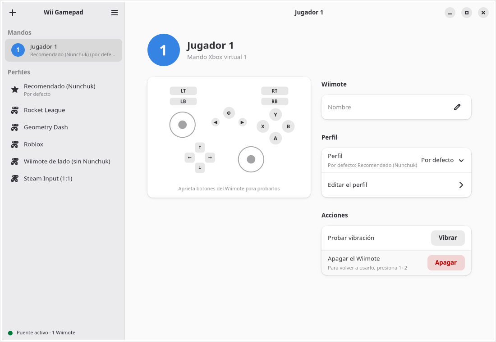
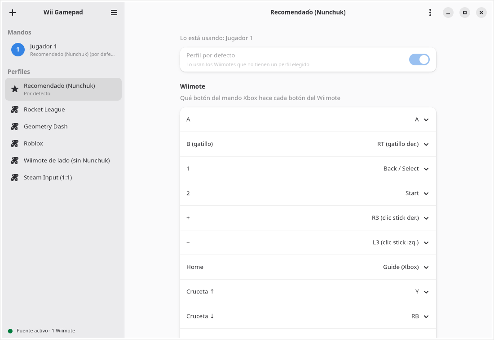
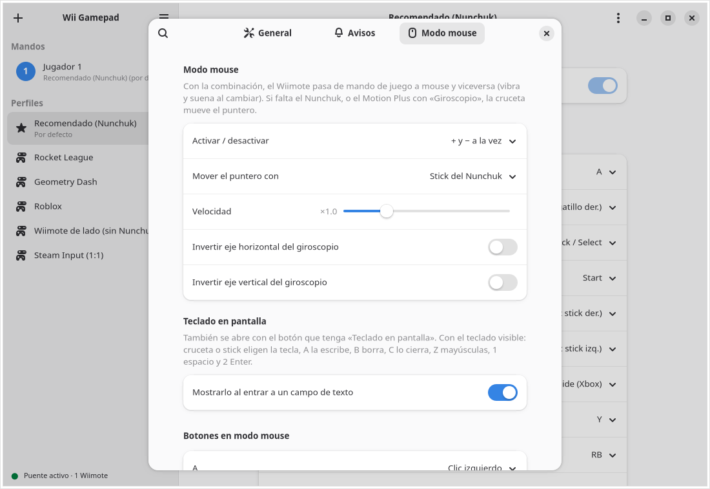
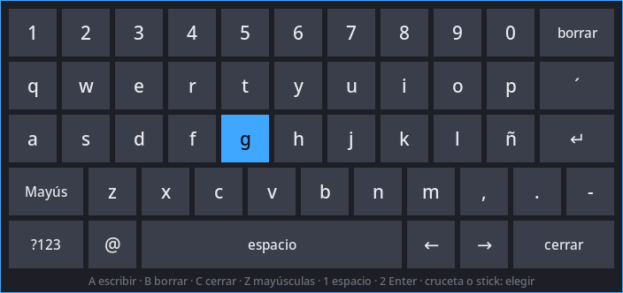

# Wii Gamepad

[](LICENSE)

[](https://ko-fi.com/alexdev07)

Use a Wii Remote (with or without Nunchuk) as an Xbox 360 controller on Linux: Steam, Proton,
Rocket League, Geometry Dash, Roblox (Sober) and any game with controller support.


*Every Wiimote button lights up on the virtual controller. At the end the profile switches
to "Geometry Dash" and the same B button becomes A, without restarting anything.*

> The app's interface is in Spanish. [Versión en español](README.md)

## Why this app

There are other ways to use a Wiimote on Linux, but none of them bring all of this together:

| | Wii Gamepad | wminput (cwiid) | xwiimote | Dolphin | SDL / Steam |
|---|:-:|:-:|:-:|:-:|:-:|
| Xbox 360 controller that any game recognizes | ✅ | ⚠️ generic keyboard/joystick | ❌ library only | ❌ emulator only | ⚠️ basic |
| Remapping window with per-game profiles | ✅ | ❌ text files | ❌ | — | ❌ |
| Changes apply instantly, no restart | ✅ | ❌ | ❌ | — | — |
| Game rumble on the Wiimote | ✅ | ❌ | — | ✅ | ⚠️ |
| Gyro (Motion Plus) as a stick, Wii-style "aim" mode | ✅ | ❌ | — | ✅ | ⚠️ no aim mode |
| Mouse mode and on-screen keyboard driven by the Wiimote | ✅ | ⚠️ mouse only | ❌ | ❌ | ❌ |
| Starts and stops with the Wiimote; saves battery | ✅ | ❌ | ❌ | ❌ | ❌ |
| Up to 4 Wiimotes at once, each with its own profile | ✅ | ⚠️ one process per Wiimote | — | ✅ | — |
| Maintained | ✅ | ❌ abandoned | ⚠️ barely | ✅ | ✅ |

It relies on the kernel's own driver (`hid-wiimote`), so it doesn't reimplement the Wiimote
protocol: it only translates its events into a virtual controller through `uinput`.

## Install

Download the project ([Releases](https://github.com/AlexGameDev07/wii-gamepad/releases) or
`git clone https://github.com/AlexGameDev07/wii-gamepad.git`) and run, as your normal user
(**no sudo**; it asks for your password when needed):

```sh
cd wii-gamepad
./install.sh --service  # recommended: starts by itself when the Wiimote connects
```

| Option | What it does |
|---|---|
| `./install.sh` | Dependencies, permissions, commands and menu entry |
| `--service` | Also starts the bridge when the Wiimote turns on and stops it when it turns off |
| `--hide-raw` | Steam stops showing the raw Wiimote as a second controller |
| `--uninstall` | Removes everything (system packages stay installed) |

The installer detects your distro, installs packages, enables Bluetooth and loads the kernel
modules. If the distro has no `python3-evdev` package, it builds it with pip in an isolated
environment.

| Distro | Before `./install.sh` |
|---|---|
| Fedora, Ubuntu, Debian, Mint, Pop!_OS, openSUSE, Arch, Manjaro, EndeavourOS, Void | Nothing |
| Alpine | `apk add bash` |
| Gentoo, Solus | Nothing (supported, untested) |
| Fedora Silverblue, Bazzite and other immutable distros | `rpm-ostree install python3-evdev python3-tkinter`, then reboot |
| SteamOS, NixOS | Not supported by the installer (manual install) |

Requirements: a kernel with `hid-wiimote` and `uinput` (every common one), BlueZ, Python 3.9+
and `sudo` or `doas`. The window uses GTK4 and libadwaita 1.5 or newer (installed by
`install.sh`); older distros such as Debian 12 get the classic window instead. Works on X11 and
Wayland.

## Pair the Wiimote (first time only)

1. Open your desktop's Bluetooth settings, or run `bluetoothctl` and then `scan on`.
2. Remove the battery cover and press the red **SYNC** button (the LEDs blink). It shows up
   as `Nintendo RVL-CNT-01` (or `-TR`).
3. Pair it. If asked for a PIN, leave it empty or choose "no PIN". With `bluetoothctl`:
   `pair XX:XX:...`, `trust XX:XX:...` and `connect XX:XX:...`.
4. Mark it as **trusted**: from then on pressing 1+2 is enough to reconnect.

## Usage



1. Turn the Wiimote on with 1+2.
2. With `--service` the bridge starts by itself; otherwise run `wii-gamepad` and keep the
   terminal open.
3. Open **Wii Gamepad** from the app menu (`wii-gamepad-config`).

The sidebar lists the connected Wiimotes (player number and battery) and the profiles. Each
Wiimote's page sets its profile and name, tests rumble and shows its virtual controller live;
each profile's page chooses which Xbox button every Wiimote/Nunchuk button maps to. The window
adapts to its size, follows the system's light or dark style and is animated; ☰ →
**Preferencias** has the theme, a switch to turn animations off, alerts and mouse mode.



Changes apply instantly and are saved in `~/.config/wii-gamepad/config.json`, with one profile
per game: Recommended (Nunchuk), Rocket League, Geometry Dash, Roblox (gyro camera),
Sideways Wiimote (NES style) and Steam Input (1:1). The **default** profile (the star) is used by
Wiimotes without one of their own; `wii-gamepad --profile "Geometry Dash"` changes it.

## Several Wiimotes

Connect up to 4 Wiimotes: each one is a player with its own virtual Xbox controller, and its LED
shows the player number. Every Wiimote remembers its profile and name (by its Bluetooth address).
If one turns off, its virtual controller stays, so the game doesn't lose it and the Wiimote gets
the same number back. One Wiimote at a time can use mouse mode; Preferences chooses whether
anyone can or only player 1.

### Recommended layout (Wiimote + Nunchuk)

| Wiimote / Nunchuk | Xbox | Why |
|---|---|---|
| Nunchuk stick | Left stick | Movement |
| Z / C (left index) | LT / LB | Left hand triggers |
| B (right index) | RT | Right hand trigger |
| A | A | Main button, under the thumb |
| D-pad ↑ ← → ↓ | Y, X, B, RB | Right thumb, same order as the Xbox diamond |
| − / + | L3 / R3 | Sprint, crouch, aim… |
| 1 / 2 | Back / Start | Pause and map: out of the way so you don't hit them by accident |
| Home | Guide | Steam menu |

## Mouse mode



Press **+ and − together** and the Wiimote drives the desktop mouse; press them again to go back
to gamepad mode (it rumbles and plays a sound). Nunchuk stick (or gyro, or D-pad) moves the
pointer, A/Z click, the D-pad scrolls and goes back/forward, and 2 opens the on-screen keyboard.
Everything is configurable in **Preferencias → Modo mouse**.

### On-screen keyboard



In mouse mode, entering a text field shows a keyboard at the bottom of the screen (button 2 also
toggles it). It never steals focus from the field: pick keys with the D-pad or stick, A types,
B deletes, C closes, Z is shift, 1 is space and 2 is Enter. It types correctly with your keyboard
layout (latam, es, us…) because it reads it from the desktop. Text fields are detected through
desktop accessibility (AT-SPI); for Firefox and Chrome run
`gsettings set org.gnome.desktop.interface toolkit-accessibility true` and restart the browser.

## Steam Input

Steam sees the virtual controller as a physical one, so its layout is applied *on top of* the
profile here. Remap in only one place: either use the **Steam Input (1:1)** profile and remap in
Steam, or keep Steam's default layout and use this app's profiles.

## Gyro, rumble, alerts and battery

- **Gyro (Motion Plus):** turning the Wiimote moves the camera. In "Aim" mode, pointing to a side
  keeps the camera turning; press **B + D-pad ↓** to recenter. It recalibrates by itself every
  time the Wiimote rests still for a second.
- **Rumble:** games that rumble an Xbox controller rumble the Wiimote too (its motor is on/off
  only, so soft rumble feels choppy).
- **Alerts:** a sound plays on the PC on connect, disconnect, low battery, recenter, Nunchuk and
  mouse mode. In **Preferencias → Avisos** you choose each sound and whether it also shows a desktop
  notification (by default: connect with the battery level, disconnect, and battery below 20 %
  and 10 %). Add your own sounds to `~/.config/wii-gamepad/sonidos/`. Each Wiimote's battery
  shows in the sidebar and on its page.
- **Battery:** after 10 idle minutes the Wiimote is turned off (`wii-gamepad --idle 20` changes
  it, `--idle 0` disables it). The accelerometer is only enabled by profiles that use tilt.

## Tests

No Wiimote needed: they create a fake Wiimote, Nunchuk and Motion Plus with `uinput` and check
what comes out of the virtual controller (buttons, sticks, gyro, rumble, live profiles, mouse
mode, disconnects and two Wiimotes at once). The second one installs the app on 7 distros using containers.

```sh
python3 tests/test_bridge.py   # requires having run install.sh
tests/install-matrix.sh        # requires podman or docker
python3 docs/escena.py         # regenerates the GIF and screenshots in this README
```

## Support the project

Wii Gamepad is and will stay free. If it helps you and you want to buy me a coffee,
you can do it on [Ko-fi](https://ko-fi.com/alexdev07). Thanks!

## License and credits

Code under [GPL-3.0-or-later](LICENSE). Sounds: [Interface Sounds](https://kenney.nl/assets/interface-sounds)
by Kenney, public domain ([CC0](sonidos/LICENSE-Kenney.txt)).
