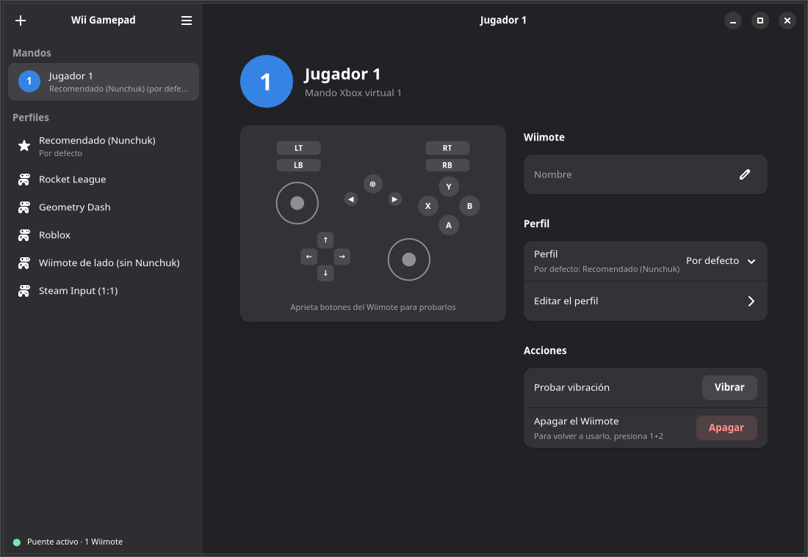
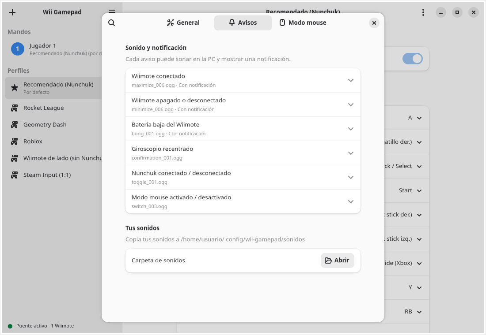

# Wii Gamepad

[](LICENSE)

[](https://ko-fi.com/alexdev07)

Usa un Wiimote (con o sin Nunchuk) como mando de Xbox 360 en Linux: Steam, Proton,
Rocket League, Geometry Dash, Roblox (Sober) y cualquier juego con soporte de mando.


*Cada botón del Wiimote se ilumina en el mando virtual. Al final se cambia al perfil
«Geometry Dash» y el mismo botón B pasa a ser A, sin reiniciar nada.*

[English version](README.en.md)

## Por qué esta app

Hay otras formas de usar un Wiimote en Linux, pero ninguna junta todo esto:

| | Wii Gamepad | wminput (cwiid) | xwiimote | Dolphin | SDL / Steam |
|---|:-:|:-:|:-:|:-:|:-:|
| Mando Xbox 360 que reconoce cualquier juego | ✅ | ⚠️ teclado/joystick genérico | ❌ solo librería | ❌ solo dentro del emulador | ⚠️ básico |
| Ventana para remapear, con perfiles por juego | ✅ | ❌ archivos de texto | ❌ | — | ❌ |
| Cambios al instante, sin reiniciar | ✅ | ❌ | ❌ | — | — |
| Vibración de los juegos en el Wiimote | ✅ | ❌ | — | ✅ | ⚠️ |
| Giroscopio (Motion Plus) como stick, modo «apuntar» estilo Wii | ✅ | ❌ | — | ✅ | ⚠️ sin modo apuntar |
| Modo mouse y teclado en pantalla manejados con el Wiimote | ✅ | ⚠️ solo mouse | ❌ | ❌ | ❌ |
| Arranca y se apaga solo con el Wiimote; ahorra batería | ✅ | ❌ | ❌ | ❌ | ❌ |
| Hasta 4 Wiimotes a la vez, cada uno con su perfil | ✅ | ⚠️ un proceso por Wiimote | — | ✅ | — |
| Mantenido | ✅ | ❌ abandonado | ⚠️ poco | ✅ | ✅ |

Usa el driver oficial del kernel (`hid-wiimote`), así que no reimplementa el protocolo
del Wiimote: solo traduce sus eventos a un mando virtual con `uinput`.

## Instalación

Descarga el proyecto ([Releases](https://github.com/AlexGameDev07/wii-gamepad/releases)
o `git clone https://github.com/AlexGameDev07/wii-gamepad.git`) y, como tu usuario
normal (**sin sudo**; pedirá la contraseña cuando haga falta):

```sh
cd wii-gamepad
./install.sh --service  # recomendado: arranca solo al conectar el Wiimote
```

| Opción | Qué hace |
|---|---|
| `./install.sh` | Dependencias, permisos, comandos y acceso en el menú |
| `--service` | Además arranca el puente solo al encender el Wiimote y lo cierra al apagarlo |
| `--hide-raw` | Steam deja de mostrar el Wiimote original como segundo mando |
| `--uninstall` | Lo quita todo (deja instalados los paquetes del sistema) |

El instalador detecta la distro, instala los paquetes, activa el Bluetooth y carga los
módulos del kernel. Si la distro no tiene el paquete `python3-evdev`, lo compila con pip
en un entorno aislado.

| Distro | Antes de `./install.sh` |
|---|---|
| Fedora, Ubuntu, Debian, Mint, Pop!_OS, openSUSE, Arch, Manjaro, EndeavourOS, Void | Nada |
| Alpine | `apk add bash` |
| Gentoo, Solus | Nada (soportadas, sin probar) |
| Fedora Silverblue, Bazzite y otras inmutables | `rpm-ostree install python3-evdev python3-tkinter` y reiniciar |
| SteamOS, NixOS | No soportadas por el instalador (instalación manual) |

Requisitos: kernel con `hid-wiimote` y `uinput` (todos los habituales), BlueZ, Python 3.9+
y `sudo` o `doas`. La ventana usa GTK4 y libadwaita 1.5 o más reciente (las instala
`install.sh`); en distros más antiguas, como Debian 12, se abre la ventana clásica.
Funciona en X11 y Wayland.

## Vincular el Wiimote (solo la primera vez)

1. Abre la configuración de Bluetooth del escritorio, o en una terminal:
   `bluetoothctl` y luego `scan on`.
2. Quita la tapa de las pilas del Wiimote y presiona el **botón rojo SYNC** (las luces
   parpadean). Aparece como `Nintendo RVL-CNT-01` (o `-TR`).
3. Vincúlalo. Si pide PIN, déjalo vacío o elige «sin PIN». Con `bluetoothctl`:
   `pair XX:XX:...`, `trust XX:XX:...` y `connect XX:XX:...` (la MAC sale en el `scan`).
4. Márcalo como **de confianza** (`trust`): así, después basta con presionar 1+2 para
   que se conecte solo.

## Uso


1. Enciende el Wiimote con 1+2: se conecta solo si ya está vinculado.
2. Ejecuta `wii-gamepad` y deja la terminal abierta. Con `./install.sh --service` no hace
   falta: el puente arranca solo al encender el Wiimote y se cierra al apagarlo.
3. Abre **Wii Gamepad** desde el menú de aplicaciones (`wii-gamepad-config`).

A la izquierda están los Wiimotes conectados (con su número de jugador y su batería) y los
perfiles. En la página de cada Wiimote eliges su perfil, le pones nombre, pruebas la
vibración y ves su mando virtual en vivo. En la de cada perfil eliges qué botón de Xbox
corresponde a cada botón del Wiimote/Nunchuk.


La ventana se adapta a su tamaño (estrecha, la barra lateral se pliega), sigue el tema
claro u oscuro del sistema y tiene animaciones. En el menú ☰ → **Preferencias** están el
tema, un interruptor para quitar las animaciones, los avisos y el modo mouse.



Los cambios se aplican al instante, sin reiniciar nada. Se guardan en
`~/.config/wii-gamepad/config.json`, con un perfil por juego:

| Perfil | Pensado para |
|---|---|
| Recomendado (Nunchuk) | Uso general; es la base de los perfiles creados con **+** |
| Rocket League | Nunchuk: stick y Z/C para acelerar y frenar; flechas: X/Y/LB/RB |
| Geometry Dash | A, B y Z saltan |
| Roblox | Girar el Wiimote mueve la cámara (giroscopio) |
| Wiimote de lado (sin Nunchuk) | Wiimote en horizontal, estilo NES |
| Steam Input (1:1) | Remapear en Steam Input (ver abajo) |

El perfil **por defecto** (la estrella) es el de los Wiimotes que no tienen uno elegido.
Para cambiarlo desde la terminal: `wii-gamepad --profile "Geometry Dash"`.

## Varios Wiimotes

Conecta hasta 4 Wiimotes a la vez: cada uno es un jugador con su propio mando Xbox virtual,
y su LED muestra el número (1 a 4). Cada Wiimote recuerda su perfil y su nombre (se
reconoce por su dirección Bluetooth), así que uno puede jugar con «Rocket League» y otro
con «Recomendado».

Si un Wiimote se apaga, su mando virtual sigue existiendo: el juego no lo pierde y, al
volver a encenderlo, recupera su mismo número. El modo mouse lo usa un Wiimote a la vez;
en Preferencias eliges si puede usarlo cualquiera o solo el jugador 1.

### Layout recomendado (Wiimote + Nunchuk)

| Wiimote / Nunchuk | Xbox | Por qué |
|---|---|---|
| Stick del Nunchuk | Stick izquierdo | Moverse |
| Z / C (índice izq.) | LT / LB | Gatillos de la mano izquierda |
| B (índice der.) | RT | Gatillo de la mano derecha |
| A | A | Botón principal, bajo el pulgar |
| Cruceta ↑ ← → ↓ | Y, X, B, RB | Pulgar derecho, mismo orden que el rombo de Xbox |
| − / + | L3 / R3 | Correr, agacharse, apuntar… |
| 1 / 2 | Back / Start | Pausa y mapa: están lejos y no se pulsan sin querer |
| Home | Guide | Menú de Steam |

## Modo mouse


Presiona **+ y − a la vez** para que el Wiimote controle el mouse del escritorio; otra vez
y vuelve a ser mando de juego (vibra y suena al cambiar). Siempre arranca en modo juego.

| Wiimote / Nunchuk | Modo mouse (por defecto) |
|---|---|
| Stick del Nunchuk | Mover el puntero |
| A / Z | Clic izquierdo / derecho |
| B | Borrar (Retroceso) |
| C | Enter |
| Cruceta ↑ ↓ | Rueda (scroll) |
| Cruceta ← → | Atrás / Adelante (Alt+← / Alt+→) |
| 1 / 2 / Home | Esc / Teclado en pantalla / Super |

Todo se cambia en **Preferencias → Modo mouse**: la combinación, cada botón, la velocidad y con qué se
mueve el puntero (stick, giroscopio o cruceta; el giroscopio tiene casillas para invertir
cada eje). Sin Nunchuk, la cruceta mueve el puntero.

### Teclado en pantalla


En modo mouse, al entrar a un campo de texto aparece un teclado abajo de la pantalla
(también con el botón 2). No le quita el foco al campo: lo manejas con el Wiimote.

| Botón | Con el teclado visible |
|---|---|
| Cruceta o stick | Elegir tecla |
| A | Escribir la tecla elegida |
| B | Borrar (mantenido, sigue borrando) |
| C | Cerrar el teclado |
| Z | Mayúscula para la siguiente letra |
| 1 / 2 | Espacio / Enter |

La tecla «?123» cambia a los símbolos; «´» y «¨» son acentos (luego elige la vocal). Escribe
bien con tu distribución de teclado (latam, es, us…) porque la lee del escritorio.

Para detectar los campos de texto usa la accesibilidad del escritorio (AT-SPI). Las apps de
GNOME/GTK funcionan tal cual; **Firefox y Chrome** solo la usan si está activada:
`gsettings set org.gnome.desktop.interface toolkit-accessibility true` y reinicia el navegador.
Donde no se detecte, ábrelo con el botón 2.

## Steam Input

Steam ve el mando virtual como si fuera el mando físico, así que su layout se aplica *encima*
del perfil de aquí. Remapea en un solo lado:

- **En Steam:** activa el perfil **Steam Input (1:1)** y no lo cambies; cada botón del Wiimote
  llega como un botón distinto, y en Steam puedes usar el layout que quieras por juego.
- **Aquí:** deja en Steam el layout de mando por defecto y usa los perfiles de esta app.

Si cambias de perfil aquí con un layout de Steam puesto, ese layout queda descuadrado.

## Giroscopio (Motion Plus)

Si tu Wiimote tiene Motion Plus (los modelos «-TR» lo traen integrado), puede mover la
cámara. Se activa en la sección «Giroscopio» del perfil y viene puesto en el stick derecho en los
perfiles Recomendado y Roblox. Se calibra solo cada vez que el Wiimote queda quieto un
segundo. Hay dos modos:

- **Velocidad:** girar el Wiimote gira la cámara; si dejas de girarlo, se detiene.
- **Apuntar (estilo Wii):** apuntar a un lado hace que la cámara siga girando hacia ese
  lado. Apunta adonde quieras que sea «el frente» y presiona **B + Cruceta ↓** para
  recentrar (sentirás un toque de vibración). La combinación se cambia o se desactiva
  en Preferencias; en modo Velocidad sirve para recalibrar el giroscopio al instante.

## Vibración

Los juegos que hacen vibrar el mando de Xbox también hacen vibrar el Wiimote. Su motor
solo enciende o apaga, así que las vibraciones suaves se notan entrecortadas. Se
desactiva en Preferencias («Vibrar cuando el juego lo pida»), y «Probar vibración», en la
página de cada Wiimote, la comprueba.

## Avisos y batería



Suena un aviso al conectar el Wiimote, al apagarse, con la batería baja, al recentrar el
giroscopio, al conectar o quitar el Nunchuk y al cambiar al modo mouse. Se oye en la PC; al
conectar, además, el Wiimote vibra. En **Preferencias → Avisos** eliges cada sonido (o «Ninguno») y si
quieres también una notificación de escritorio. Por defecto la hay al conectar (con el nivel
de batería), al desconectar y cuando la batería baja del 20 % y del 10 %. Para añadir tus
sonidos, cópialos a `~/.config/wii-gamepad/sonidos/`.

La batería de cada Wiimote se ve en la barra lateral y en su página. Las notificaciones usan
`notify-send` (paquete `libnotify`), que instala `install.sh`.

## Ahorro de batería

Si no tocas el Wiimote en 10 minutos el puente lo desconecta y se apaga solo. Para
volver a usarlo presiona 1+2. El tiempo se cambia en Preferencias («Apagar sin uso») o
con `wii-gamepad --idle 20` (`--idle 0` lo desactiva).

El acelerómetro solo se activa en los perfiles que usan la inclinación, porque
encendido hace que el Wiimote transmita sin parar y gaste más pila.

## Notas

- **Roblox (Sober):** el instalador le da acceso a mandos (`flatpak override --device=input`).
  Si lo instalas después, ejecuta de nuevo `./install.sh`.
- **Mando no detectado en un juego de Steam:** en *Propiedades → Mando*, activa Steam Input.
- **Inclinación:** si la cámara va al revés, activa «Invertir eje vertical» en el perfil.
- **Ventana clásica:** `WII_GAMEPAD_TK=1 wii-gamepad-config` abre la ventana anterior (Tkinter),
  la que se usa donde no hay libadwaita 1.5.

## Pruebas

Sin Wiimote: crean un Wiimote, Nunchuk y Motion Plus falsos con `uinput` y comprueban lo
que sale por el mando virtual (botones, sticks, giroscopio, vibración, perfiles en vivo,
modo mouse, desconexiones y dos Wiimotes a la vez). La segunda instala la app en 7 distros con contenedores.

```sh
python3 tests/test_bridge.py   # necesita haber ejecutado install.sh
tests/install-matrix.sh        # necesita podman o docker
python3 docs/escena.py         # regenera el GIF y las capturas de este README
```

## Apoya el proyecto

Wii Gamepad es y seguirá siendo gratis. Si te sirve y quieres invitarme un café,
puedes hacerlo en [Ko-fi](https://ko-fi.com/alexdev07). ¡Gracias!

## Licencia y créditos

Código bajo [GPL-3.0-or-later](LICENSE): puedes usarlo, estudiarlo, modificarlo y
compartirlo, siempre que lo que distribuyas siga siendo libre.

Sonidos: [Interface Sounds](https://kenney.nl/assets/interface-sounds) de Kenney,
dominio público ([CC0](sonidos/LICENSE-Kenney.txt)).
